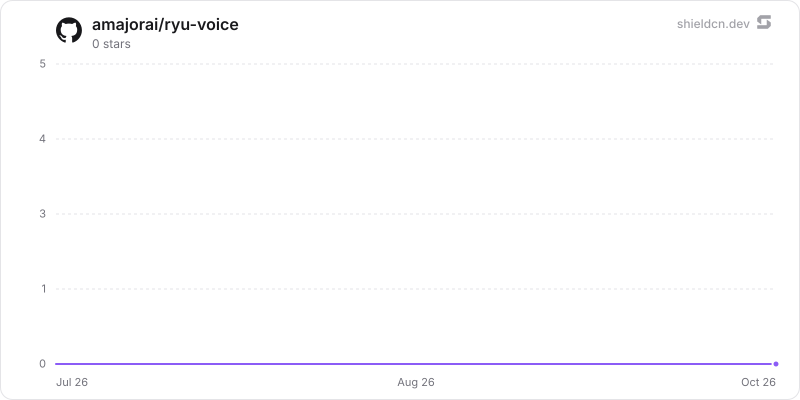

<div align="center">

# voice

</div>

The universal TTS sidecar: a self-contained Python HTTP front over several text-to-speech engines (Kokoro, Kitten, Pocket), part of Ryu's speech data path.

> **The public home of `ryu-voice`.** Source, builds, and releases live here —
> binaries for every platform are attached to each release.
>
> This tree is generated from the Ryu monorepo, so commits pushed here
> directly are replaced on the next sync. **Pull requests are welcome** —
> open them here and they are ported into the monorepo, then flow back out.
> Ryu as a whole: https://github.com/amajorai/ryu

## Install

**App:** [Install](ryu://apps/com.ryu.voice) (opens the Ryu desktop app and asks you to confirm)

**CLI:**

```bash
ryu apps add com.ryu.voice
```

## Source & build

The **source of record** for the universal Ryu TTS sidecar — a self-contained
Python HTTP front over several text-to-speech engines. Install its
dependencies (`pip install -r sidecar/requirements.txt`) and run
`python -m ryu_tts` from `sidecar/`; Core manages it as a sidecar in a
full Ryu install.

## License

Apache-2.0 — see [LICENSE](./LICENSE).

## Companion views (`ui/src/`)

- **Studio** (`views/StudioView.tsx`, `views/studio/`): speed, seed lock/reroll,
  delivery instruction, loudness, effects presets and an editable chain, file
  format, `[pause]`/paralinguistic tag inserter, pronunciation dictionary,
  long-script chunking (`text/chunk.ts`) with client-side crossfade stitching
  (`audio/stitch.ts`), a generation queue, voice design, saving presets as
  profiles, and engine licence badges with a non-commercial acknowledgement.
- **Voice Library** (`views/LibraryView.tsx`, `views/library/`): microphone
  recording through `media.recording`, transcription through
  `media.transcribe`, reference-sample cleanup, up to five samples per profile,
  an edit sheet for profile defaults, search/tags/favorites, and portable
  `ryu-voice-profile/v1` export/import (consent stays self-attested).
- **History** (`views/HistoryView.tsx`, `views/history/`): v2 takes with full
  params, replay from stored audio or by seed, regenerate, download per format,
  favorites, and "Use script", which restores the take settings in the Studio
  (`views/history/restore.ts`).
- **Stories** (`views/StoriesView.tsx`, `views/stories/`): multi-speaker line
  editor, `Speaker: line` import, per-line audition cache, and full render.

Shared state is `state/voice-studio.tsx`; storage keys and the take-audio
retention policy are documented in `ui/src/constants.ts` and `ui/src/bridge.ts`.
The speak request contract (`seed`, `instruct`, `reference_text`, `effects`,
`normalize`, `format`) is validated in `ui/src/schemas.ts` and flows through the
host `media.tts` verb to Core `/api/voice/speak` and the sidecar `POST /generate`.

Tests: `bun run test` (unit), `bun run check-types`, and `bun run test:rendered`
(Playwright: the preview and ExtensionHost suites plus `test:features`, which
runs the Studio controls, Library, and History/Stories suites).

## Release note: sidecar wheel

Core provisions the sidecar from a pinned, hash-checked satellite wheel
(`apps/core/src/sidecar/providers/ryutts/mod.rs`). The sidecar features added
here (seed, instruct, reference text, effects, loudness, mp3/ogg/flac encoding,
pause tags, chunking, time-stretch, and the Chatterbox and Qwen3-TTS engines)
reach provisioned nodes only with the next `amajorai/ryu-voice` wheel release,
when the release tag, wheel file name, and sha256 there are bumped together.
Until then a provisioned node runs the older wheel, which ignores the new
request fields and always returns WAV; the Companion keeps working against it.
An editable checkout (`bun run dev:tts`) uses the new code immediately.

## Parts

- **`sidecar/` — the Ryu TTS sidecar (Python, out-of-process).** A thin FastAPI
  runtime (`ryu-tts-sidecar`) that fronts many TTS engines behind one contract
  (`GET /health`, `GET /engines`, `GET /effects`, `POST /engines/install`,
  `POST /generate` → `audio/wav` or the requested `format`, `POST /unload`).
  Fenced out of the bun/turbo workspace; runs on its own Python toolchain. Core
  owns lifecycle, model downloads, the catalog, and the `?engine=` selector on
  `/api/voice/speak`; this process is a pure inference runtime (the same way Core
  manages whisper.cpp's `whisper-server` and sd.cpp's `sd-server`). See
  `sidecar/README.md`.
- **Manifest** — `apps-store/voice/manifest.json` (id `@ryu/voice`) declares the
  Companion UI, speech-generation and model-management permissions, and app-owned storage. Speech
  generation goes through the host's `media.tts` capability and Core's existing
  `/api/voice/speak` route. The host obtains the available TTS engine catalog
  through `media.ttsEngines`.
- **Voice cloning** — the Studio normalizes imported samples into a small mono
  WAV. Core validates the bounded WAV data URL, stages it in the private voice
  reference directory for one synthesis request, and removes the temporary file
  when that request ends. It rejects remote URLs and arbitrary file paths. A
  cloning-capable engine such as Pocket TTS can be installed on demand from the
  Studio. The Linux installer selects CPU-only PyTorch wheels.

audio.cpp is a separate Core-managed native runtime, not a replacement for this
Python sidecar. Selecting `audiocpp` routes through its loopback OpenAI-compatible
server; the existing `ryutts` process remains available for its own engine registry.

## Engine registry (swap seam)

The HTTP layer never grows a per-engine branch. Adding an engine is one
`EngineConfig` row in `ryu_tts/registry.py` plus one
`ryu_tts/backends/<module>.py` implementing the `TtsBackend` protocol
(`load`/`generate`/`unload`/`is_loaded`). Seeded: **`kokoro`** (Kokoro 82M — the
Ryu default, CPU-only ONNX; Core auto-downloads weights + voice pack during
onboarding and injects them via `RYU_KOKORO_MODEL`/`RYU_KOKORO_VOICES`),
`kitten` (KittenTTS), `pocket` (Kyutai Pocket TTS, voice cloning via
`reference_audio`), `chatterbox`/`chatterbox_turbo` (Resemble AI Chatterbox),
and `qwen`/`qwen_custom_voice`/`qwen_voice_design` (Qwen3-TTS). The Chatterbox
and Qwen families pin incompatible `transformers` versions; install one per
environment. Heavy inference deps are optional extras and imported lazily
inside backend methods, so a missing dep degrades only that one engine.

## Run

`cd apps-store/voice/ui && bun run dev` to work on the Companion UI. Run
`bun run build` there to produce `ui/dist/index.html`.

Run the TTS service with `bun run dev:tts`, or from `sidecar/`:
`pip install -e ".[kokoro]"` then
`python -m ryu_tts` (serves `127.0.0.1:8085`, `RYU_TTS_PORT` to override).

## Star History

<a href="https://github.com/amajorai/ryu-voice/stargazers">
  <picture>
    <source media="(prefers-color-scheme: dark)" srcset="./.github/shieldcn/star-chart-dark.svg" />
    
  </picture>
</a>
